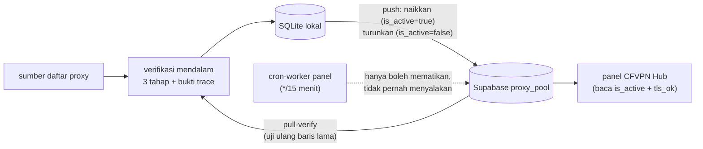
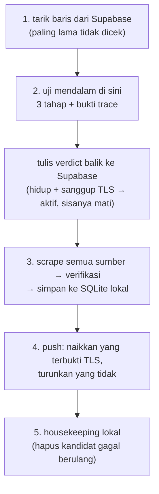

# Pan ProxyScanner

Pengumpul + verifikator proxy publik berbahasa Go, dengan **website** dan **API HTTP**.
Dirancang untuk memasok proxy yang bisa dipakai tunnel **VLESS** (handler TCP lewat SOCKS5
atau HTTP CONNECT), jadi verifikasinya bukan sekadar "port terbuka" tetapi handshake
sungguhan sampai ada respons HTTP dari target.

## Instal (unduh versi rilis)

Cukup satu tautan yang selalu menunjuk versi terbaru:

**https://github.com/jhopan/Pan-ProxyScanner/releases/latest**

| Perangkat | Berkas | Cara pakai |
|---|---|---|
| Windows 64-bit | `panproxyscanner-<versi>-windows-amd64.zip` | ekstrak, jalankan `panproxyscanner.exe serve`, buka `http://localhost:8787` |
| macOS (Apple Silicon) | `panproxyscanner-<versi>-macos-arm64.tar.gz` | `tar xzf …`, `chmod +x panproxyscanner`, `./panproxyscanner serve` |
| macOS (Intel) | `panproxyscanner-<versi>-macos-amd64.tar.gz` | idem (build Intel) |
| Linux (amd64/arm64) | `panproxyscanner-<versi>-linux-<arch>.tar.gz` | `tar xzf …`, `chmod +x panproxyscanner`, `./panproxyscanner serve` |
| Android | `panproxyscanner.apk` | pasang (izinkan "instal dari sumber tidak dikenal"), lalu isi alamat panel, mis. `http://192.168.1.10:8787` |

> macOS: rilis belum ditandatangani/notarized Apple, jadi saat pertama dijalankan bisa muncul
> peringatan Gatekeeper — klik kanan → **Open**, atau
> `xattr -dr com.apple.quarantine panproxyscanner`.

Setiap rilis tersedia dalam dua bentuk: rilis berversi (mis.
`/releases/tag/v0.1.0`, arsip permanen) dan rilis **`latest`** yang selalu diperbarui ke
versi terbaru dengan aset yang sama. Jadi untuk memperbarui, cukup unduh ulang dari
`/releases/latest`.

Android: APK-nya adalah panel dalam WebView (varian *debug* yang sudah ditandatangani agar
bisa langsung dipasang). **APK ini tidak membawa biner Go di dalamnya** — scanner tetap
berjalan di komputer (Windows/macOS/Linux) dan APK hanya menjadi tampilan panelnya lewat
jaringan lokal. Arahkan ke alamat LAN mesin yang menjalankan scanner; dashboard menampilkan
daftar URL LAN yang bisa dipakai dari HP.

## Kebutuhan (kalau membangun sendiri)

- Go 1.22+ (diuji di Go 1.26). Tidak butuh cgo — SQLite-nya pure Go.
- Koneksi internet (untuk mengambil daftar sumber dan memverifikasi proxy).

## Menjalankan

```bash
go run . serve                       # website + API di http://0.0.0.0:8787 (bisa diakses dari LAN)
go run . serve -scrape-now           # sekaligus jalankan siklus pertama
go run . scrape                      # satu siklus, progres di terminal, lalu keluar
go run . sources                     # uji semua sumber: status, jumlah proxy, kecepatan
go run . check 1.2.3.4:1080 5.6.7.8:4145   # uji proxy langsung (SOCKS5/HTTP + TLS 443)
go run . verify -jobs 8 1.2.3.4:1080 5.6.7.8:4145   # uji + SIMPAN verdict ke database
go build -o panproxyscanner.exe .     # bikin binary
```

`check` hanya menampilkan hasil; **`verify` menuliskannya ke database** (RecordAlive/RecordDead,
termasuk `tls_ok`/`alt_ok`/`exit_ip`). Dipakai operator untuk memperbarui verdict tertentu
tanpa menunggu siklus penuh — mis. setelah menambah kandidat manual. Keduanya menerima
`-jobs N` (paralel) dan `-tls=false` / `-alt=false` untuk uji cepat.

`check` mencetak status tiap proxy beserta bukti tahapannya: latensi satu permintaan (dan
total verifikasi dalam tanda kurung), `tls=ya/tidak` (tunnel 443 dengan TLS terverifikasi),
`alt=ya/tidak` (port 8443/2053), serta `exit=` + kode negara asli dari trace Cloudflare.
Ini penanda apakah proxy benar-benar bisa dipakai VLESS, bukan hanya HTTP :80.

Catatan populasi: proxy gratis (terutama residensial ID) **naik-turun antar pengecekan** —
satu pengujian bisa `HIDUP` lalu `MATI` beberapa detik kemudian. Karena itu `verify`/siklus
menyimpan verdict terakhir, dan pool panel hanya menerima baris yang lolos ≥2 kali. Pakai
`-tls=false -alt=false` untuk uji cepat, atau `-tls=false` kalau hanya ingin mengecek tunnel
TCP dasar.

Website: `http://<ip-lan>:8787` — halaman itu juga menampilkan daftar URL LAN yang bisa dipakai
dari perangkat lain. Panel memakai **login** (bawaan `admin` / `admin`; ganti di
**Scheduler → Akun & API**). Tata letaknya bersidebar: **Dashboard**, **Daftar proxy**,
**Sumber**, **Scheduler**, **Tunnel CF**, **Dokumentasi API**.

Siklus otomatis, jadwal, kandidat per siklus, jumlah verifikasi paralel, filter negara,
housekeeping, akun admin, token API, dan public URL semuanya bisa diubah dari panel
(tersimpan di `~/.panproxyscanner/settings.json`), tanpa restart proses.

Referensi lengkap API: [`docs/API.md`](docs/API.md).

### Mengekspos lewat Cloudflare Tunnel

Panel sudah bind `0.0.0.0`, jadi cukup jalankan cloudflared di mesin yang sama:

```bash
# quick tunnel (tanpa domain)
cloudflared tunnel --url http://localhost:8787

# named tunnel (domain sendiri)
cloudflared tunnel login
cloudflared tunnel create panproxyscanner
cloudflared tunnel route dns panproxyscanner scraping.domainmu.com
cloudflared tunnel run --url http://localhost:8787 panproxyscanner
```

Perintahnya juga ditampilkan lengkap di halaman **Tunnel CF**, beserta status apakah
permintaan saat ini sudah lewat Cloudflare (header `Cf-Ray`). Kalau panel dibuka ke publik,
**isi Token API** supaya `/api/*` tidak bisa dipakai orang lain.

Siklus otomatis mengikuti `auto` di `settings.json` (bawaan: nonaktif, interval 30 menit).
Nyalakan dari panel website atau `POST /api/auto/start`, atau jalankan pertama kali dengan
`-interval 30m` supaya nilai awal itu langsung tersimpan.

Opsi penting:

| Flag | Arti | Default |
|---|---|---|
| `-addr` | alamat listen website + API (`0.0.0.0` = bisa diakses LAN) | `0.0.0.0:8787` |
| `-db` | berkas SQLite | `proxies.db` |
| `-config` | lokasi `settings.json` | `~/.panproxyscanner/settings.json` |
| `-jobs` / `-cap` / `-min-sources` / `-offset` | nilai awal kalau `settings.json` belum ada | `150` / `20000` / `0` / `0` |
| `-interval` | nilai awal siklus otomatis (0 = ikut settings) | `0` |
| `-fresh` | jendela kesegaran statistik/API | `6h` |
| `-refresh-limit` / `-refresh-after` | berapa baris lama diverifikasi ulang & setelah berapa lama | `300` / `30m` |
| `-dial-timeout` / `-stage-timeout` / `-probe-timeout` | batas waktu tiap tahap verifikasi | `4s` / `4s` / `6s` |
| `-purge-dead` | hapus catatan mati lebih tua dari durasi ini saat start | `0` |

Nilai `-jobs`, `-cap`, `-min-sources`, `-interval`, `-fresh`, `-refresh-*` hanya dipakai untuk
membuat `settings.json` pertama kali; setelah itu panel website yang jadi sumber kebenaran.

## API

Semua respons API memakai header CORS `*` sehingga bisa dipanggil langsung dari frontend lain.

| Endpoint | Kegunaan |
|---|---|
| `POST /api/login` · `POST /api/logout` · `GET /api/me` | sesi website (cookie `ps_session`) |
| `GET /api/proxies` | JSON daftar proxy. Filter: `alive`, `protocol`, `country`, `max_ping`, `min_sources`, `fresh_minutes`, `limit` (≤5000), `offset`, `order=ping\|last_checked\|sources` |
| `GET /api/proxies.txt` | daftar `ip:port` polos (siap ditempel ke generator VLESS), filter sama |
| `GET /api/stats` | ringkasan database + progres siklus terakhir |
| `GET /api/sources` | katalog sumber + hasil siklus terakhir per sumber |
| `POST /api/scrape?cap=&offset=&jobs=&min_sources=` | memulai siklus di latar belakang (satu siklus dalam satu waktu) |
| `POST /api/stop` | menghentikan siklus yang berjalan |
| `GET /api/vless/clash?host=&uuid=&port=443` | konfigurasi Clash/Mihomo dengan entri VLESS untuk setiap proxy |
| `GET /api/vless/raw?host=&uuid=&port=443` | URI `vless://` untuk setiap proxy |
| `GET /api/sources` | katalog sumber dari database (nama, URL, jenis, aktif, hasil siklus terakhir) |
| `POST /api/sources` | tambah sumber: `{url, name?, kind?, optional?}` |
| `DELETE /api/sources?name=` | hapus sumber |
| `POST /api/sources/toggle?name=&enabled=` | nyalakan/matikan sumber |
| `GET /api/tunnel` | status Cloudflare, alamat listen, perintah cloudflared, `config.yml`, public URL |
| `GET /api/supabase/status` | konfigurasi Supabase + catatan sinkron terakhir (`?test=1` untuk cek langsung) |
| `POST /api/supabase/test` · `/push` · `/pull-verify` | uji koneksi, kirim proxy hidup, tarik & verifikasi baris lama |
| `GET /api/pipeline` · `POST /api/pipeline/run` | status / menjalankan alur harian penuh |
| `GET /api/health` | cek hidup (publik, tanpa login) |

Contoh:

```bash
curl "http://127.0.0.1:8787/api/proxies.txt?max_ping=1500&fresh_minutes=60&limit=50"
curl "http://127.0.0.1:8787/api/stats"
curl -X POST "http://127.0.0.1:8787/api/scrape?cap=5000&jobs=200"
curl -o vless.yaml "http://127.0.0.1:8787/api/vless/clash?host=vpn-worker-prem.adelia140845.workers.dev&uuid=<uuid>&max_ping=2000&limit=100"
```

YAML yang dihasilkan memakai format panel CFVPN Hub: WebSocket path `/<ip>-<port>`,
`servername` = host worker, dan grup `url-test` supaya klien selalu memilih proxy tercepat.

## Konfigurasi lewat `.env`

Salin `.env.example` → `.env` (otomatis dibaca saat start; `-env <path>` untuk lokasi lain).
Prioritas: **`.env` > flag CLI > `settings.json`**.

| Variabel | Arti |
|---|---|
| `PS_BIND_LAN` | `true` = listen semua interface (LAN bisa akses), `false` = hanya `127.0.0.1` |
| `PS_HOST` / `PS_PORT` / `PS_ADDR` | host, port, atau alamat lengkap listen (`PS_ADDR` menang) |
| `PS_DB` / `PS_CONFIG` | lokasi database & `settings.json` |
| `PS_ADMIN_USER` / `PS_ADMIN_PASSWORD` | akun panel (default `admin`/`admin`) |
| `PS_API_TOKEN` | token untuk klien mesin (`X-Api-Token`) |
| `PS_TUNNEL_NAME` / `PS_TUNNEL_DOMAIN` / `PS_PUBLIC_URL` | informasi tunnel Cloudflare |
| `PS_AUTO`, `PS_INTERVAL_MINUTES`, `PS_CAP`, `PS_JOBS`, `PS_MIN_SOURCES`, `PS_FRESH_MINUTES` | nilai awal siklus |

Contoh: `PS_BIND_LAN=false` + `PS_PORT=8891` → panel hanya di `127.0.0.1:8891` (aman kalau
diekspos lewat cloudflared). Log saat start menampilkan `konfigurasi .env dibaca: N nilai (listen ...)`.

## Mengelola sumber dari website

Menu **Sumber** menampilkan seluruh katalog yang tersimpan di database: nama, jenis, URL,
status HTTP, jumlah proxy, dan ms dari siklus terakhir — plus tombol **matikan/nyalakan** dan
**hapus** per sumber, serta formulir **Tambah sumber** (URL apa pun yang memuat pola `ip:port`).
Sumber ditambahkan/disunting di situ langsung dipakai pada siklus berikutnya; katalog bawaan
(55 entri) diisi otomatis saat pertama kali dijalankan.

## Sinkronisasi ke Supabase (untuk cfvpn-hub)

Panel CFVPN Hub tidak perlu lagi memverifikasi proxy sendiri (yang membuat bandwidth
bengkak) — aplikasi ini yang mengerjakan verifikasi, lalu hasilnya dikirim ke tabel
`proxy_pool` di Supabase:



Pembagian peran (satu penilai, banyak pengawas):

| Komponen | Peran | Yang TIDAK boleh dilakukan |
|---|---|---|
| `panproxyscanner` (aplikasi ini) | satu-satunya yang memverifikasi mendalam dan menaikkan `is_active` | — |
| `cron-worker` panel | mengawasi baris yang sudah aktif, mematikan yang terbukti mati | menyalakan baris (cek dangkal bisa lolos di proxy non-TLS) |
| panel CFVPN Hub | membaca daftar, tidak memverifikasi | menandai `is_active` |

Sebabnya nyata: dari 360 baris lama di tabel yang diuji ulang, hanya **1 yang masih hidup** —
`is_active` yang diisi pengecek HTTP dangkal hampir seluruhnya salah (proxy itu tidak sanggup
tunnel TLS 443 yang dibutuhkan VLESS).

Menu **Supabase** di panel:

| Tombol / isian | Fungsi |
|---|---|
| URL + key + tabel | kredensial project Supabase (tabel default `proxy_pool`) |
| **Tes koneksi** | cek koneksi dan jumlah baris (total & aktif) |
| **Push sekarang** | sinkronkan keputusan verifikasi: proxy hidup yang **terbukti sanggup TLS** dinaikkan (`is_active=true`), proxy hidup yang terbukti tidak sanggup TLS **diturunkan** (`is_active=false`) |
| **Tarik & verifikasi** | tarik baris terlama dari Supabase, uji mendalam di sini, tulis verdict balik (hidup + sanggup TLS → aktif; sisanya mati) |
| **Otomatis dorong hasil siklus** | setiap siklus selesai, push dijalankan sendiri |
| **Prune baris mati** | hapus baris mati di Supabase yang lebih tua dari N hari (butuh `docs/supabase-policies.sql` sekali) |
| **Uji TLS 443** | verifikasi tambahan `CONNECT 443` + TLS terverifikasi → kolom `tls_ok`, filter `?tls=true` |
| **Uji port 8443/2053** | bukti proxy mau meneruskan port non-standar → kolom `alt_ok`, filter `?alt=true` |
| **Push hanya proxy sanggup TLS** | `push_require_tls`: panel menerima hanya proxy yang lolos uji TLS 443 |
| **Matikan sumber kosong** | sumber yang berkali-kali tidak menghasilkan proxy dimatikan otomatis (bisa dinyalakan lagi dari menu Sumber) |

`push` mengurutkan proxy dengan skor (`ok_count*100 - fail_count*25 - ping/10`), lalu menyaring:

| Saringan | Aturan |
|---|---|
| rasio | lewati proxy yang `fail_count > ok_count` |
| verdict segar | hanya memakai hasil cek ≤ **90 menit** (`pushMaxAge`), bukan `fresh_minutes` 6 jam |
| kematangan | perlu **2× berhasil** (`ok_count ≥ 2`) sebelum naik ke pool; sekali hidup lalu mati tidak cukup |
| exit IP | satu alamat keluar per **/24** — lima port dari mesin yang sama tidak memenuhi pool |
| TLS | **hanya menaikkan yang terbukti sanggup TLS 443**; sisanya justru diturunkan |

Status sinkronisasi menuliskan semuanya, mis.:
`push 180 baris (naik 49, turun 131, wajib TLS: true, verdict segar ≤ 90 menit, 30 ditahan (baru 1× berhasil), 2 dilewati (exit IP sama), kolom tls_ok/alt_ok/exit_ip ikut dikirim)`.

Angka pengukuran: dari 154 proxy yang lolos uji HTTP, **51 sanggup tunnel TLS 443 (33%)** dan 37
sanggup port non-standar. Sisa dua pertiga kalau dibiarkan aktif akan menjadi konfigurasi
VLESS yang mati di sisi pengguna.

`ping_ms` adalah latensi **satu** permintaan yang berhasil lewat proxy, dihaluskan dengan EWMA
(`0,6 × lama + 0,4 × baru`) supaya satu sampel lambat tidak langsung menjatuhkan peringkat.
Proxy mati mengosongkan `ping_ms`.

Kalau kolom bukti (`tls_ok`, `alt_ok`, `exit_ip`) belum ada di tabel, `push` tetap berjalan:
kolom itu dilepas otomatis dan dicatat di status sinkronisasi. Setelah
`docs/supabase-policies.sql` dijalankan di Supabase, kolom bukti langsung ikut terkirim tanpa
perlu restart.

### Sekali saja (setup di sisi Supabase & panel)

Sudah dikerjakan 12 Nov 2026 lewat Supabase CLI (project baru di akun Adelia):

1. **Project**: `lumbbmhhmkcnxunuryjr` (org "Adelia Hub", region Singapura) → skema lengkap
   dari `cfvpn-hub/supabase/schema.sql` (tabel + kolom bukti `tls_ok`/`alt_ok`/`exit_ip` +
   policy RLS termasuk `DELETE`). Jalankan ulang kapan saja dengan:
   `npx supabase@latest db query --remote=lumbbmhhmkcnxunuryjr -f ../cfvpn-hub/supabase/schema.sql --yes`
2. **Kredensial**: `supabase_url`/`supabase_key` aplikasi ini sudah menunjuk project baru
   (menu Supabase → tes koneksi → `ok: true`).
3. **Bukti cepat**: `curl -X POST "http://127.0.0.1:8787/api/supabase/push?limit=500"` →
   status sinkronisasi menyebut `kolom tls_ok/alt_ok/exit_ip ikut dikirim`.

Project lama `cgflrpjavyotvolnvcnl` masih tersimpan sebagai cadangan (tidak lagi menerima
update); `docs/supabase-policies.sql` hanya relevan kalau project itu dipakai lagi.

```bash
curl -X POST "http://127.0.0.1:8787/api/supabase/push?limit=200"      -H "X-Api-Token: <token>"
curl -X POST "http://127.0.0.1:8787/api/supabase/pull-verify?limit=100&jobs=100" -H "X-Api-Token: <token>"
```

Dengan `supabase_auto_push=true` dan `supabase_pull_limit=50`, panel CFVPN Hub selalu
menemukan daftar segar (`is_active=true` + `last_checked` baru) tanpa satu pun request
verifikasi dari browser.

## Pipeline harian (alur utama)

Jadwal (menu **Pipeline**) menjalankan satu alur penuh — cocok dijalankan sekali tiap pagi:



| Isian di menu Pipeline | Arti |
|---|---|
| Mode jadwal | **harian** (jam tetap, mis. `05:30`) atau **interval** (tiap N menit) |
| Penjadwal aktif | `auto` — menyalakan jadwal |
| Jalankan pipeline penuh | `true` = jadwal menjalankan alur 1-4; `false` = hanya siklus scraping |
| Uji baris Supabase per pipeline | berapa baris lama dari Supabase diuji di langkah 2 |
| Push proxy ke Supabase | berapa proxy dikirim di langkah 4 |
| **Jalankan sekarang** | memicu alur penuh tanpa menunggu jam |

```bash
curl -X POST http://127.0.0.1:8787/api/pipeline/run -H "X-Api-Token: <token>"
curl http://127.0.0.1:8787/api/pipeline -H "X-Api-Token: <token>"   # status + hasil per langkah
```

Hasil uji nyata (satu pipeline): langkah 1 → 30 baris Supabase diuji (0 hidup, 10,7 s) ·
langkah 2 → 220 kandidat diperiksa, 14 hidup (30 s) · langkah 3 → 97 proxy dikirim (0,6 s).
Jadwal harian juga diuji betulan: disetel `HH:MM` dua menit ke depan dan pipeline berjalan
sendiri pada jam itu.

### Konsumsi Supabase (free plan)

Free plan: **500 MB database, 5 GB egress/bulan, 1 GB file, 50.000 MAU**, tanpa backup
otomatis. Perkiraan pemakaian alur ini:

| Pos | Perkiraan | Batas free |
|---|---|---|
| Ukuran tabel `proxy_pool` (≈2,8 ribu baris × ~130 B) | ~0,4 MB | 500 MB |
| Satu pipeline (tarik 500 + push 300 + verdict batch) | ~0,2 MB egress, ~10-20 request | 5 GB/bulan |
| Harian (1× pipeline) | ~0,2 MB · bulanan ~6 MB | ~0,1% dari 5 GB |
| Churn update (500 baris/hari) | ditangani autovacuum | — |

Kesimpulannya aman jauh dari batas. Yang lebih perlu dijaga justru mesin ini (port efemeral
Windows + perilaku ISP), bukan Supabase.

## Cara kerja

1. **Ambil semua sumber** (`internal/sources`) paralel — 55 daftar mentah (raw GitHub, API
   teks/JSON, tabel HTML) memakai satu parser generik: pola `ip:port` di mana saja, JSON yang
   memisah field `ip`/`port`, dan JSON yang ter-escape (`\"ip\":\"…\"`). IP privat/reserved dibuang.
2. **Prioritas kandidat**: yang tercantum di banyak sumber didahulukan (sinyal kualitas —
   daftar mass-scan berisi ratusan ribu entri yang hampir semuanya mati), lalu port yang umum
   dipakai proxy (`1080`, `3128`, `4145`, `8080`, `443`, …).
3. **Verifikasi** (`internal/checker`) — tiga tahap, semuanya lewat tunnel proxy (SOCKS5 dulu,
   lalu HTTP CONNECT), dan **setiap tahap harus menghasilkan bukti keaslian**, bukan sekadar
   status HTTP:

   | Tahap | Yang diminta | Bukti yang diterima |
   |---|---|---|
   | 1. HTTP :80 | `GET http://cp.cloudflare.com/cdn-cgi/trace` | status 200 + header `cf-ray` + isi trace dengan `h=cp.cloudflare.com` |
   | 2. TLS :443 | `GET https://cp.cloudflare.com/cdn-cgi/trace` di dalam tunnel TLS | handshake TLS **dengan verifikasi sertifikat** (root CA sistem) + trace asli |
   | 3. TLS :8443/:2053 | trace yang sama di port non-standar | tunnel byte mentah ke port arbitrer (VLESS sering di situ) |

   Hasilnya bukan cuma hidup/mati: `tls_ok` (sanggup TLS 443 — syarat VLESS), `alt_ok`
   (sanggup port lain), dan `exit_ip` + negara asli dari `ip=`/`loc=` di trace.
   Proxy yang membajak HTTP (204 palsu, portal kafe, iklan) atau MITM TLS gugur, karena
   trace Cloudflare tidak bisa dipalsukan tanpa sertifikat valid.

   Hasil `tls_ok`/`alt_ok` disimpan sebagai **verdict terakhir** (bukan "pernah bisa"), jadi
   proxy yang kehilangan kemampuan TLS langsung turun peringkat dan tidak lagi dikirim ke panel.

   Waktu pengukuran penting: proxy publik sehat sering butuh 7-12 detik untuk satu permintaan
   penuh dan latensinya berubah-ubah. Karena itu satu kali timeout **tidak** langsung berarti
   mati — tahap diulang sekali lagi, dan hanya kalau keduanya gagal proxy dicatat mati.
   Setiap koneksi ditutup dengan RST (`SetLinger(0)`) supaya port efemeral tidak habis karena
   TIME_WAIT saat memverifikasi puluhan ribu kandidat.
4. **Simpan** ke SQLite (`internal/store`): `alive`, `protocol`, `country`, `tls_ok`, `alt_ok`,
   `exit_ip`, `ping_ms`, `last_checked`, `ok_count`, `fail_count`, `sources`. Negara diambil
   dari metadata sumber, dan kalau sumber tidak menyebutkannya dipakai `loc=` dari trace
   (negara tempat proxy benar-benar keluar). Jadi bisa difilter per negara (`?country=SG,ID`)
   tanpa layanan geo eksternal.
5. **Siklus otomatis** menyegarkan baris lama (default 300 baris per 30 menit) dan memutar
   slice kandidat (`-offset`) supaya kandidat baru terus dicoba. Jatah refresh dipakai untuk
   baris **hidup** lebih dulu (itu produk yang dipakai panel); baris mati baru diuji ulang
   kalau umurnya 24× lebih tua (30 menit → 12 jam) — cukup untuk mendeteksi proxy yang hidup
   kembali tanpa membakar waktu untuk ribuan kandidat mass-scan. Jadi kemampuan
   `tls_ok`/`alt_ok` proxy yang masih berguna selalu segar tiap siklus.

   Jadwal yang dipakai sekarang: **interval 120 menit**, `cap=1200`, `jobs=150`, pipeline penuh
   (tarik → scrape → push → prune → housekeeping). Tanpa batas `cap` kecil, satu siklus bisa
   memeriksa 20 ribu kandidat (~10 menit) dan tidak selesai sebelum jadwal berikutnya —
   1.200 kandidat per siklus + rotasi `auto_rotate` memberi cakupan yang sama tanpa menumpuk.
   Kalau ada siklus manual yang sedang jalan, langkah pipeline menunggu (maks 15 menit) lalu
   mencatat "dilewati" alih-alih gagal.

   Keterbatasan yang diketahui: sumber IPv6 dibuang seluruhnya (`IsPublicIP` hanya menerima
   IPv4) karena format path worker `/<ip>-<port>` tidak bisa membawa alamat IPv6.

## Integrasi dengan panel CFVPN Hub

```bash
# daftar proxy mentah untuk generator lokal
curl -s "http://127.0.0.1:8787/api/proxies.txt?max_ping=2000&fresh_minutes=120&limit=100"

# konfigurasi klien siap pakai (Clash/Mihomo) yang menunjuk worker VLESS
curl -s "http://127.0.0.1:8787/api/vless/clash?host=<worker>.workers.dev&uuid=<uuid>" -o vless.yaml
```

Worker VLESS menerima proxy dari path WebSocket `/<ip>-<port>`, jadi daftar dari API ini bisa
langsung dipakai tanpa perubahan format.

## Struktur

```
main.go                       # subcommand serve|scrape|sources|check|verify|version + flag
internal/sources/sources.go   # katalog 55 sumber + parser generik + kode negara
internal/checker/checker.go   # verifikasi 3 tahap: trace HTTP :80, TLS :443, port non-standar
internal/store/store.go       # SQLite (pure Go) + query filter/statistik/per-negara
internal/settings/settings.go # pengaturan yang bisa diubah dari website
internal/scraper/scraper.go   # orkestrasi siklus, prioritas, verifikasi, penjadwal
internal/api/server.go        # API HTTP + endpoint VLESS (Clash/raw) + pengaturan
internal/api/web/index.html   # dashboard (tanpa aset eksternal)
android/                      # aplikasi Android (WebView) → APK rilis
docs/API.md                   # dokumentasi API lengkap
.github/workflows/release.yml # build biner + APK, rilis versi & "latest"
AGENTS.md                     # aturan kerja untuk kontributor/agen
```

## Merilis versi baru

```bash
git add -A && git commit -m "chore: siap rilis v0.1.1"
git tag v0.1.1
git push origin main --tags
```

GitHub Actions (`.github/workflows/release.yml`) akan:

1. `gofmt` + `go vet` + `go test` — gagal berarti rilis batal;
2. membangun biner Windows (amd64), Linux (amd64, arm64) dengan `-ldflags -X main.version=<tag>`;
3. membangun **APK** Android;
4. membuat rilis **`v0.1.1`** berisi semua aset itu, lalu memindahkan tag **`latest`** dan
   memperbarui rilis **`latest`** dengan aset yang sama.

Cek versi biner: `panproxyscanner version` (mis. `panproxyscanner v0.1.1`).
